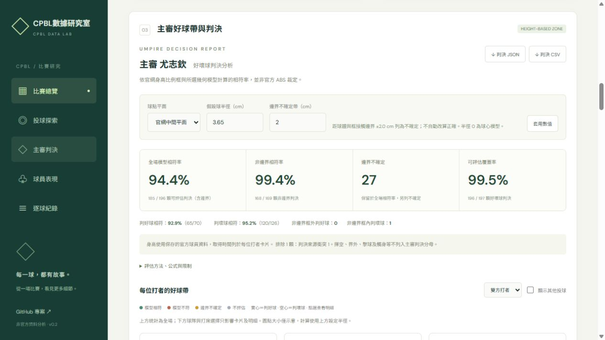

# 正式部署紀錄

2026-10-24 已將 GitHub main 的 `24d6a64` 部署至 Vercel 專案 `lokcyis-projects/cpbl`。

- 正式網址：https://cpbl-blush.vercel.app
- 管理頁：https://vercel.com/lokcyis-projects/cpbl
- 建置：`npm run build`，輸出 `dist`，`api/` 以 Vercel Functions 執行。
- 驗證首頁、`/api/schedule?date=2026-07-21`、`/api/game?id=2026-C-4`、`/api/players?id=2026-C-4` 均回應 200。
- 瀏覽器確認品牌、首頁文案、主審模型相符率、疑似誤判清單及球隊歸屬正常。

部署來源為已提交版本，未包含工作目錄內尚未提交的整季資料收錄。GitHub 自動部署整合尚未連結；目前由 Vercel CLI 手動部署。未在程式碼中保存登入憑證。

